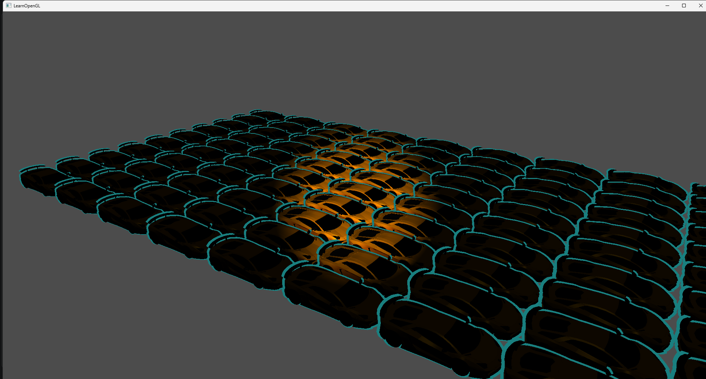
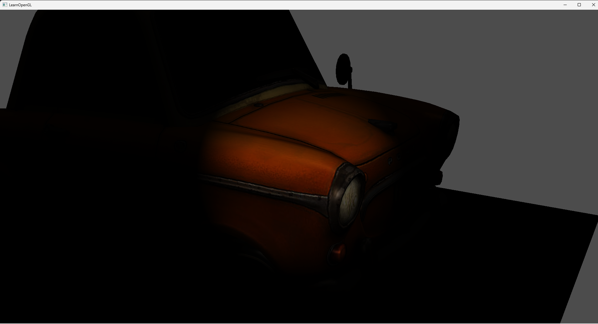
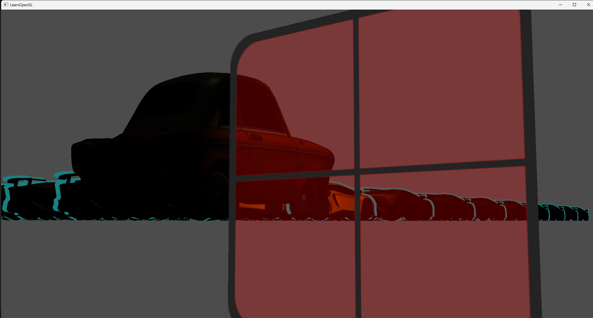
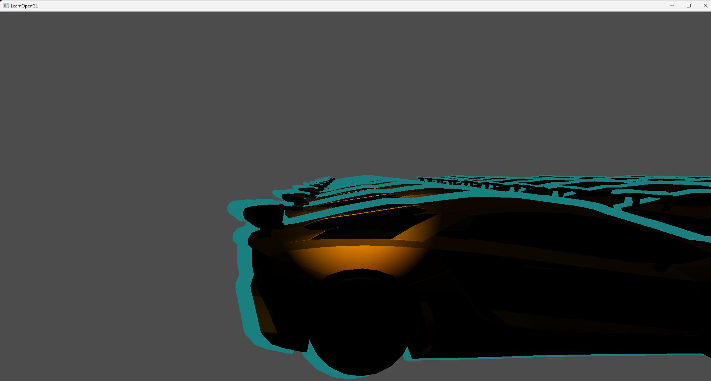

# OpenGL 3D Rendering Engine

A real-time 3D rendering engine written in C++ and modern OpenGL. It wraps the repetitive parts of OpenGL setup (windows, shaders, buffers, textures, model loading) so you can focus on building and rendering a 3D scene.



## Features

- **Modern OpenGL pipeline**: vertex buffer objects, transformation matrices and custom GLSL vertex and fragment shaders
- **3D model loading** with [Assimp](https://github.com/assimp/assimp), including textured meshes
- **Texture rendering and filtering**
- **Depth testing** for correct occlusion
- **Stencil testing**, used to draw object outlines (the teal borders in the screenshots)
- **Alpha blending** for transparent surfaces
- **Spotlight lighting** with soft falloff
- **Configurable framebuffers** to adjust the final visuals
- **Large scenes**: the overview screenshot above renders a grid of well over a hundred model instances
- Clean class structure, with `Mesh`, `Shader` and `Camera` classes wrapping the raw OpenGL objects

## Screenshots

| | |
|---|---|
|  |  |
| Textured model lit by a spotlight | Alpha blending: a translucent window in front of the scene |



*Stencil-based outline around a model, with spotlight highlights.*

## Requirements

- Windows with a GPU and driver that support **OpenGL 4.6**
- [MSYS2](https://www.msys2.org/) (UCRT64 environment) with Clang
- GLFW, Assimp and GLM
- GLAD is included in the repo (`src/glad.c`)

## Building

### 1. Install the toolchain

Open the **MSYS2 UCRT64** shell and run:

```bash
pacman -Syu
pacman -S mingw-w64-ucrt-x86_64-clang mingw-w64-ucrt-x86_64-glfw mingw-w64-ucrt-x86_64-assimp mingw-w64-ucrt-x86_64-glm
```

Then add `C:\msys64\ucrt64\bin` to your Windows `PATH` so the executable can find its DLLs at runtime, and restart your terminal or editor.

### 2. Build

From the repository root:

```powershell
mkdir build
clang++ -std=c++26 -g src/core/*.cpp src/systems/*.cpp src/rendering/*.cpp src/glad.c -Iinclude -lglfw3 -lassimp -lopengl32 -lgdi32 -o build/main.exe
```

If you use VS Code, the same build is available as the task **C/C++: Native MSYS2 Clang Build** in `.vscode/tasks.json`.

### 3. Run

Run from the repository root so the engine can find the shaders and resources:

```powershell
.\build\main.exe
```

<!--
Uncomment and fill in once you've confirmed your controls:

## Controls

| Input | Action |
|---|---|
| W / A / S / D | ... |
| Mouse | ... |
| Esc | ... |
-->

## Project structure

```
.
├── src/
│   ├── core/         engine core
│   ├── systems/      engine systems
│   ├── rendering/    rendering code
│   └── glad.c        OpenGL loader
├── include/          headers
├── shaders/          GLSL vertex and fragment shaders
├── res/              models and textures
└── .vscode/          VS Code build task
```

## License

Free to use for anyone who wants to build something with it.

---

Created by Nathan Small
